# Git 多分支協作教學講義

最後更新：2026-10-28

這份講義以你們的分支模型（main / develop / feature / hotfix）為主線，建議依序閱讀：第 1 節看全貌，第 2～7 節逐一講解功能，第 8 節是速查表，第 9 節用一個完整版本週期串起所有步驟。

每節的結構都一樣：觀念與圖解 → git 指令 → SourceTree 操作（分隔線中的框框）→ 可能發生的問題 → 案例。

> 圖解使用 Mermaid `gitGraph` 語法。GitLab、GitHub、VS Code（Markdown Preview Mermaid Support 擴充）、Typora、Obsidian 都能直接顯示成分支圖。

## 1. 分支策略總覽

你的分支模型是簡化版的 Git Flow：**develop 是日常開發的匯流點，main 只放上線（PRD）版本並打 tag，feature 與 hotfix 是短命分支，用完即刪。**

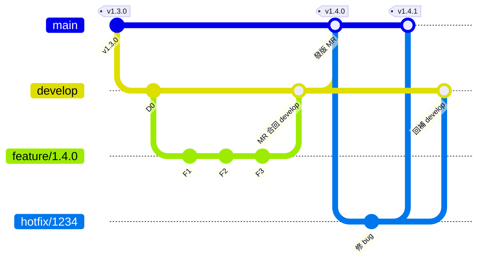

讀法：feature 只會回到 develop；只有 develop（發版）與 hotfix 會進 main；hotfix 進 main 之後一定要再回補 develop。

| 分支 | 從哪裡開 | MR 回到哪裡 | 生命週期 | 誰可以直接 push |
| --- | --- | --- | --- | --- |
| `main` | — | — | 永久 | 無人（只接受 MR，受保護） |
| `develop`（default） | `main` | `main`（發版時） | 永久 | 無人（只接受 MR，受保護） |
| `feature/<version_number>` | `develop` | `develop` | 數天～數週 | 該功能開發者 |
| `hotfix/<issue_number>` | `main`（線上版本） | `main`，並回補 `develop` | 數小時～數天 | 修 bug 的人 |

**一個重要觀念：** hotfix 必須從 `main`（或線上那個 tag）開，而不是從 `develop` 開。因為 `develop` 上可能已經有還沒上線的新功能，從那裡開 hotfix 會把未完成的東西一起帶上 PRD。

日常最常用的指令：

```bash
# Start a feature from the latest develop
git switch develop
git pull origin develop
git switch -c feature/1.4.0

# Work, commit, push
git add .
git commit -m "feat: add export button"
git push -u origin feature/1.4.0
# Then open an MR: feature/1.4.0 -> develop on GitLab
```

---

> **SourceTree 操作｜開 feature 分支到第一次 push**
>
> 以 macOS 版為準，Windows 版名稱大致相同。左側是「側邊欄」（BRANCHES / TAGS / REMOTES / STASHES），上方是「工具列」。
>
> 1. **切到 develop**：側邊欄 BRANCHES 下雙擊 `develop`。
> 2. **拉最新**：工具列 **Pull** → Remote branch to pull 選 `develop` → OK。
> 3. **開分支**：工具列 **Branch** → New Branch 填 `feature/1.4.0` → 勾 Checkout new branch → Create Branch。
> 4. **Commit**：工具列 **Commit** → 在 Unstaged files 勾檔案（或 Stage All）→ 填訊息 → Commit。
> 5. **第一次 Push**：工具列 **Push** → 勾 `feature/1.4.0` 與 Track 欄（等同 `-u`）→ OK。
> 6. **開 MR**：SourceTree 不處理 MR，到 GitLab 網頁開 `feature/1.4.0 → develop`。

---

## 2. Merge 與 Merge Request（MR）

**Merge 是把另一個分支的歷史「合進」目前分支；MR 是 GitLab 上包住這個動作的流程（code review、CI、審核、再由平台幫你 merge）。** GitHub 上叫 Pull Request（PR），概念相同。

### 三種合併方式

| 方式 | 指令 | 結果 | 適合用在 |
| --- | --- | --- | --- |
| Fast-forward | `git merge --ff-only feature/x` | 目標分支沒有新 commit 時，只是把指標往前移，歷史是一直線 | 個人分支、rebase 過的 feature |
| Merge commit（no-ff） | `git merge --no-ff feature/x` | 產生一個有兩個 parent 的 merge commit，保留分支形狀 | `develop → main` 發版、hotfix 合回 |
| Squash merge | `git merge --squash feature/x` + `git commit` | feature 上的 N 個 commit 壓成 1 個，放到目標分支 | `feature → develop`，讓 develop 歷史乾淨 |

**Fast-forward**：develop 沒有新 commit，指標直接移到 D，不產生新 commit。

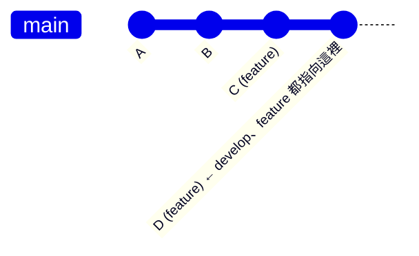

**Merge commit（--no-ff）**：保留分支形狀，多一個 merge commit M，它有兩個 parent：E 與 D。

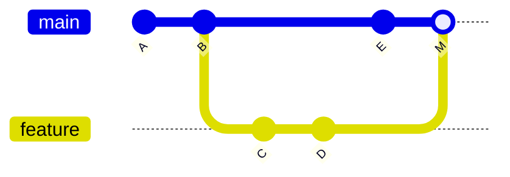

**Squash merge**：C、D 壓成一個新 commit S，develop 歷史一直線；S 只是內容複製，不是真的合併。

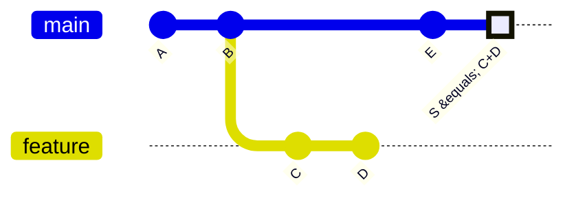

（圖中的 main 線代表 develop。）Squash 的 S 只是「內容相同」的新 commit，Git 不認為 feature 已合過，所以 squash 後不要再繼續在同一個 feature 分支上開發。

### 在你的流程裡的建議

- `feature → develop`：可用 squash，一個功能對應 develop 上一個 commit，好讀也好 revert。
- `develop → main`：**不要 squash**，用 merge commit。squash 會讓 main 與 develop 的歷史分岔，下次發版會出現一堆「重複」的差異與衝突。
- MR 前先把目標分支的最新內容帶進來（merge 或 rebase develop），衝突在自己的分支上解，不要在 develop 上解。

### 解衝突（conflict）的標準步驟

```bash
git switch feature/1.4.0
git fetch origin
git merge origin/develop        # conflict happens here
git status                      # list conflicted files
# Edit files: keep the right parts between <<<<<<< ======= >>>>>>>
git add path/to/file
git commit                      # finish the merge
git push
# Changed your mind halfway?
git merge --abort
```

---

> **SourceTree 操作｜merge 與解衝突**
>
> **把 develop 帶進 feature**
>
> 1. 側邊欄雙擊 `feature/1.4.0` 切過去，工具列 **Fetch**。
> 2. 側邊欄 REMOTES → origin → 右鍵 `develop` → **Merge origin/develop into current branch**。
> 3. 勾「Create a commit even if merge resolved via fast-forward」= `--no-ff`。
> 4. Squash：SourceTree 沒有此選項，在 GitLab MR 頁勾「Squash commits when merge request is accepted」。
>
> **解衝突**
>
> 1. 衝突檔案出現在 File Status 的 Unstaged files，圖示帶驚嘆號。
> 2. 右鍵檔案 → **Resolve Conflicts** → **Resolve Using 'Mine'**（整檔用目前分支）、**Resolve Using 'Theirs'**（整檔用合進來的）、或 **Launch External Merge Tool**（逐段挑，先在 Settings → Diff 設定工具）。
> 3. 用編輯器自己改好的：右鍵 → Resolve Conflicts → **Mark Resolved**。
> 4. 全部解完 → **Commit**（訊息已預填）→ **Push**。
> 5. 放棄這次 merge：工具列 **Terminal** 執行 `git merge --abort`。
>
> Mine / Theirs 是整檔取捨；兩邊都有要留的內容時請用 Merge Tool。

---

### 可能發生的問題

| 問題 | 原因 | 解法 |
| --- | --- | --- |
| MR 顯示「Merge blocked: conflicts」 | 目標分支在你開發期間動了同一段程式 | 在 feature 上 merge/rebase develop，解完衝突再 push |
| feature 開太久，衝突大爆發 | 長時間沒同步 develop | 至少每天或每幾天同步一次 develop；功能拆小 |
| develop → main 用了 squash，下次發版差異很怪 | main 上的 commit 與 develop 不同一個 hash，Git 認不出已合過 | 發版 MR 一律用 merge commit；已發生就把 main merge 回 develop 一次 |
| 解衝突時不小心把別人的修改吃掉 | 直接選「use mine」 | 解完跑測試；不確定就找該段程式作者（`git log -p <file>`） |

### 案例：發版 MR 誤用 squash

小王在 GitLab 對 `develop → main` 勾了 Squash commits。v1.4.0 正常上線，但下一次發版 MR 的差異居然包含上一版的所有修改。

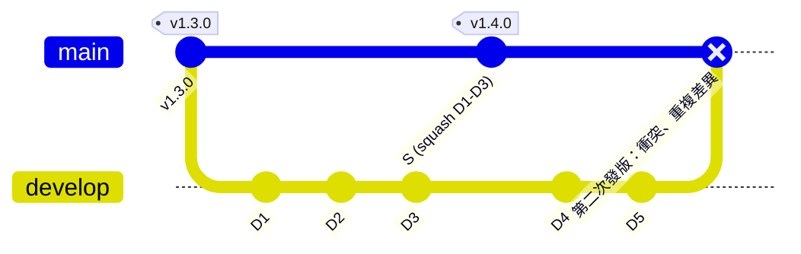

S 只是 D1–D3 內容的複本，Git 不知道 D1–D3 已經合過，所以第二次 MR 的差異會包含 D1–D5，而不是只有 D4、D5；若期間 main 有 hotfix，還會出現衝突。

修復步驟：開一張 MR `main → develop`（merge commit），把 S 帶回 develop。之後在 GitLab 發版 MR 取消勾選 squash，或在專案 Settings → Merge requests 把 Squash 設為不允許。

## 3. Rebase

**Rebase 是把你分支上的 commit「拔起來、接到另一個基底的最前端重新套用一次」。結果歷史是一直線，但每個 commit 都會變成新的 hash。**

與 merge 的差別：merge 保留「真實發生過的分岔」，多一個 merge commit；rebase 改寫歷史，讓它看起來像你是從最新的 develop 才開始寫的。

**Rebase 前**：feature 從 B 分出，develop 之後又多了 E、F。

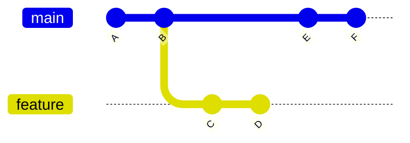

**`git rebase develop` 之後**：C、D 重放到 F 後面，變成新的 C′、D′（hash 不同）；舊的 C、D 沒有分支指向（reflog 可找回）。

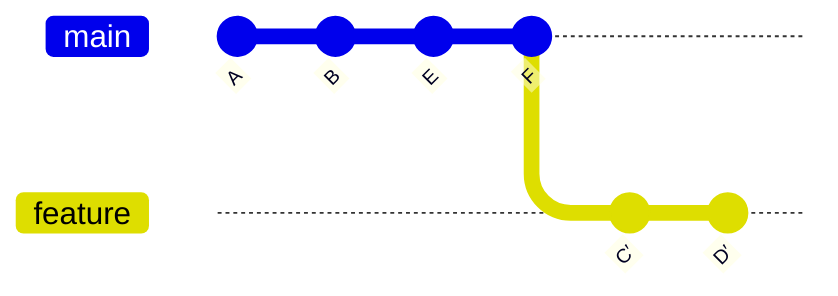

（圖中的 main 線代表 develop。）因為 C′、D′ 是新 commit，遠端的 feature 還指向舊的 D，所以 rebase 後必須 force push；別人若也在這個分支上，他手上的是舊歷史，就會出問題。

**什麼是「新的 hash」？** 每個 commit 的 hash（SHA-1）是由「檔案快照 + parent commit 的 hash + 作者/時間 + 訊息」一起算出來的。rebase 讓 C 的 parent 從 B 變成 F，所以即使程式內容一樣，hash 也完全不同；Git 是用 hash 判斷「這個 commit 是否已存在、是否合過」，不是比內容。

### 使用情境

1. **feature 同步 develop**：MR 前把自己的 feature rebase 到最新 develop，讓 MR 可以 fast-forward、歷史整齊。
2. **整理自己的 commit**（interactive rebase）：把「fix typo」「wip」這種零碎 commit 合併、改訊息、重新排序。
3. **`git pull --rebase`**：同一個分支多人開發時，避免一堆無意義的「Merge branch 'x' of origin」 commit。

```bash
# 1. Rebase feature onto latest develop
git switch feature/1.4.0
git fetch origin
git rebase origin/develop
# On conflict: fix files, then
git add <file>
git rebase --continue      # or: git rebase --abort to go back
# History was rewritten, so a normal push is rejected
git push --force-with-lease

# 2. Squash the last 4 commits interactively
git rebase -i HEAD~4       # change 'pick' to 'squash' / 'fixup' / 'reword'

# 3. Pull without creating merge commits
git pull --rebase
```

---

> **SourceTree 操作｜rebase**
>
> **feature rebase 到最新 develop**
>
> 1. 雙擊 `feature/1.4.0` 切過去，按 **Fetch**。
> 2. REMOTES → origin → 右鍵 `develop` → **Rebase current changes onto origin/develop**。
> 3. 衝突時照第 2 節解完並 Mark Resolved，再選 **Actions → Continue Rebase**；放棄選 **Actions → Abort Rebase**。
> 4. Force push：先到 Settings → Advanced 勾「Allow force push」與「Use safe force push (--force-with-lease)」，Push 對話框才會出現「Force push」。
>
> **整理 commit（interactive rebase）**
>
> 1. 在歷史圖右鍵「要整理的第一個 commit 的前一個」→ **Rebase children of \<commit\> interactively…**。
> 2. 拖曳改順序、**Squash with previous** 合併、**Edit message** 改訊息、**Delete** 刪除。
> 3. 完成後一樣要 force push。
>
> **Pull 時用 rebase**
>
> - Pull 對話框勾「Rebase instead of merge」。
> - 每次都預設這樣：用 Terminal 執行 `git config pull.rebase true`。

---

### 黃金守則

**不要 rebase 別人也在用的公用分支。** `main`、`develop` 絕對不能 rebase 也不能 force push；只在「只有你自己在用」的 feature/hotfix 上 rebase。

### 可能發生的問題

| 問題 | 原因 | 解法 |
| --- | --- | --- |
| rebase 後 `git push` 被拒絕（non-fast-forward） | 本地歷史已改寫，與遠端不同 | 用 `git push --force-with-lease`，不要用 `--force` |
| 同事也在同一個 feature 上，你 force push 後他的 commit 不見了 | 你覆蓋了遠端歷史 | 共用分支不要 rebase；已發生用 `git reflog` 找回舊 commit |
| 同一個衝突解了好幾次 | rebase 是逐個 commit 重放，每個碰到衝突都要解 | 先 `rebase -i` 把 commit 合併成少數幾個；或開啟 `git config rerere.enabled true` |
| rebase 到一半不知道自己在哪 | 進入 rebase 狀態未完成 | `git status` 看狀態；想放棄用 `git rebase --abort` |

### 案例：共用分支 force push，同事的 commit 不見了

你和小李一起開發 `feature/1.5.0`。你想跟上 develop 就做了 rebase，push 被拒絕後直接改用 `--force`。

**① 遠端 feature**：小李剛 push 了 L，你還沒 pull。

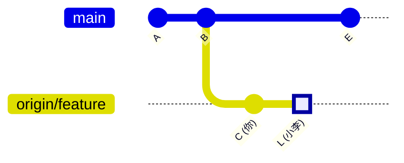

**② 你在本地 rebase**：本地只有 C，沒有 L。**③ `git push --force` 之後**：遠端被你的版本整個取代，L 從遠端消失了。

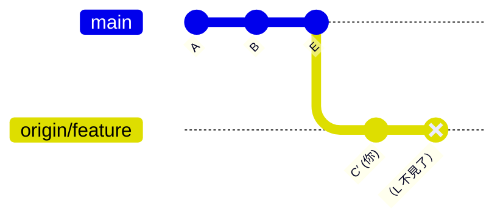

（圖中的 main 線代表 develop。）改用 `--force-with-lease`：Git 會發現遠端多了你沒看過的 L，直接拒絕 push，這個意外就不會發生。

救援步驟：請小李在他的電腦執行 `git reflog`（或直接看他本地的 feature），找到 L 的 hash。你先 `git pull`，再 `git cherry-pick <L 的 hash>` 把 L 補回來。之後共用分支一律用 merge 同步 develop。

## 4. Cherry-pick

**Cherry-pick 是「只拿某一個（或幾個）commit 的修改」複製到目前分支，不帶整個分支。複製出來的是新 commit，hash 不同。**

情境：hotfix 的修正 X 已進 main，把它補到 develop。

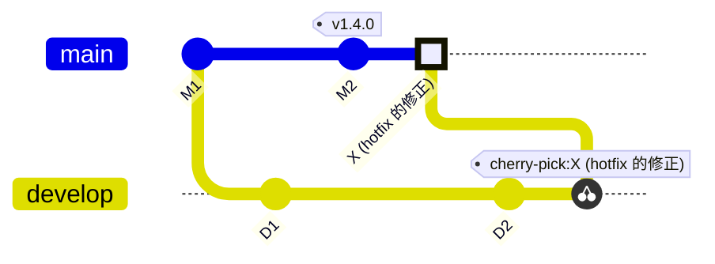

develop 只拿到 X 的修改（產生內容相同、hash 不同的 X′），沒有拿到 main 上其他 commit；這就是它和 merge 最大的不同。

### 使用情境

1. **hotfix 回補 develop**：hotfix 已合進 main，但 develop 還沒有這個修正，可以 cherry-pick 那個 fix commit 到 develop（較推薦的做法仍是開 MR，見第 6 節）。
2. **某個 feature 只想拿一個 commit**：例如 feature/1.5.0 裡有一個共用工具的修正，feature/1.4.0 也需要。
3. **commit 寫錯分支**：不小心在 develop 上 commit，可以拿到正確分支再把原處移除。

```bash
# Find the commit hash
git log --oneline main -5

# Apply one commit to the current branch
git switch develop
git cherry-pick a1b2c3d

# Several commits, or a range (exclusive of the first)
git cherry-pick a1b2c3d e4f5g6h
git cherry-pick a1b2c3d^..e4f5g6h

# Record where it came from in the message
git cherry-pick -x a1b2c3d

# On conflict
git add <file> && git cherry-pick --continue   # or --abort
```

---

> **SourceTree 操作｜cherry-pick**
>
> 1. 先切到「要接收」的分支：雙擊 `develop`。
> 2. 歷史圖左上角下拉切到 **All Branches**，找到 main 上那個 fix commit。
> 3. 右鍵該 commit → **Cherry Pick** → 確認。多個 commit：按住 Cmd 點選後再右鍵。
> 4. 衝突時照第 2 節處理，完成後 **Commit**。
> 5. 圖形介面沒有 `-x`：需要記錄來源就用 **Terminal** 執行 `git cherry-pick -x <hash>`。
>
> commit 的 hash 可在歷史圖下方的詳細資訊面板複製。

---

### 可能發生的問題

| 問題 | 原因 | 解法 |
| --- | --- | --- |
| 之後再 merge 整個分支時出現重複修改或衝突 | 同一個修改在兩邊是不同 hash 的 commit | 少量使用；用 `-x` 留下來源記錄，方便追蹤 |
| cherry-pick 後程式壞了 | 該 commit 依賴前面其他 commit 的修改 | 把依賴的 commit 一起拿，或改用 merge |
| cherry-pick 一個 merge commit 失敗 | merge commit 有兩個 parent，Git 不知道要拿哪邊的差異 | 加 `-m 1` 指定主線 parent |
| 不確定哪些 commit 還沒補到 develop | 兩邊 hash 不同無法直接比 | `git cherry -v develop main` 列出 main 有、develop 沒有的修改 |

## 5. Tag 與版本發布

**Tag 是釘在某個 commit 上、不會移動的名字。在 main 上每次上線就打一個 tag，之後要查、要回退、要開 hotfix 都以它為準。**

建議用 annotated tag（`-a`），會記錄打 tag 的人、時間與說明；版號建議採用 Semantic Versioning：`vMAJOR.MINOR.PATCH`，feature 發版加 MINOR，hotfix 加 PATCH。

### 發版步驟

1. 在 GitLab 開 MR：`develop → main`（用 merge commit，不要 squash）。
2. MR 通過、合併後，在 main 最新 commit 上打 tag 並推上去。
3. CI/CD 通常以 tag 觸發 PRD 部署。

```bash
git switch main
git pull origin main
git tag -a v1.4.0 -m "Release 1.4.0: export feature"
git push origin v1.4.0          # tags are NOT pushed by plain git push

# Inspect
git tag -l "v1.*"
git show v1.4.0
git describe --tags             # nearest tag from HEAD

# Wrong tag? delete locally and remotely, then re-tag
git tag -d v1.4.0
git push origin --delete v1.4.0
```

---

> **SourceTree 操作｜打 tag**
>
> 1. 雙擊 `main` → **Pull** 拿到合併後的最新狀態。
> 2. 工具列 **Tag**（或右鍵 commit → **Tag…**），Tag Name 填 `v1.4.0`。
> 3. 展開 **Advanced Options**：不勾 Lightweight tag（保持 annotated），填 Message。
> 4. 勾 **Push tag** → Add。漏推的話，之後在 Push 對話框勾「Push all tags」。
> 5. 刪 tag：側邊欄 TAGS → 右鍵 → **Delete** → 勾「Remove tag from all remotes」。
> 6. 從 tag 開分支：右鍵帶 tag 的 commit → **Branch…** → Specified commit → Create Branch（避開 detached HEAD）。

---

### 可能發生的問題

| 問題 | 原因 | 解法 |
| --- | --- | --- |
| tag 在本地有，GitLab 上看不到 | `git push` 預設不推 tag | `git push origin <tag>` |
| tag 打在錯的 commit | 打 tag 前沒有 pull 最新 main | 刪除後重打；若已部署或別人已拉取，建議改打新版號而非移動舊 tag |
| 想回到某版本看程式，結果變成 detached HEAD | 直接 checkout tag 不在任何分支上 | 只是看沒關係；要改就 `git switch -c hotfix/123 v1.4.0` |

## 6. Hotfix 完整流程

**Hotfix 從線上版本開、先合回 main 並打 PATCH tag，再必須回補 develop——漏掉最後一步，下次發版同一個 bug 會「復活」。**

整個 hotfix 的路徑就是第 1 節總覽圖右半部：從 v1.4.0 分出 → 合回 main 打 v1.4.1 → 回補 develop。

1. 從 main（線上 tag）開分支：`git switch -c hotfix/1234 v1.4.0`。
2. 修 bug、commit、push，開 MR：`hotfix/1234 → main`。
3. 合併後在 main 打 `v1.4.1` 並部署。
4. 回補 develop，三選一：
   - 開 MR：`hotfix/1234 → develop`（推薦，有 review 與 CI）。
   - 開 MR：`main → develop`（一次把 main 上所有 hotfix 帶回）。
   - cherry-pick fix commit 到 develop（只有一個 commit 時快速）。
5. 刪除 hotfix 分支。

```bash
git fetch origin --tags
git switch -c hotfix/1234 v1.4.0
# ...fix...
git commit -am "fix: null pointer on checkout (#1234)"
git push -u origin hotfix/1234
# MR hotfix/1234 -> main, merge, then:
git switch main && git pull
git tag -a v1.4.1 -m "Hotfix #1234"
git push origin v1.4.1
# MR hotfix/1234 -> develop (or cherry-pick), then clean up
git branch -d hotfix/1234
git push origin --delete hotfix/1234
```

---

> **SourceTree 操作｜完整 hotfix**
>
> 1. **Fetch**（確保拿到最新 tag）。
> 2. 側邊欄 TAGS 單擊 `v1.4.0`，歷史圖跳到該 commit → 右鍵 **Branch…** → `hotfix/1234`、勾 Checkout new branch → Create Branch。
> 3. 修 bug → **Commit** → **Push**（勾 Track）→ GitLab 開 MR `hotfix/1234 → main`。
> 4. MR 合併後：雙擊 `main` → **Pull** → **Tag** `v1.4.1`（勾 Push tag）。
> 5. 回補 develop：GitLab 開 MR `hotfix/1234 → develop`；或切到 develop，右鍵 fix commit → **Cherry Pick**。
> 6. 清理：右鍵 `hotfix/1234` → **Delete**；REMOTES → origin 下右鍵 → **Delete origin/hotfix/1234**。
>
> 刪除前要先切到別的分支。若 SourceTree 要求勾 Force delete，代表它判斷還沒合併，先確認再刪。

---

### 可能發生的問題

| 問題 | 原因 | 解法 |
| --- | --- | --- |
| hotfix 上線後，把未完成的功能也帶上 PRD | hotfix 從 develop 開 | 一律從 main / 線上 tag 開 |
| 下一版發布後同一個 bug 又出現 | hotfix 沒回補 develop，發版解衝突時又選了 develop 的舊程式 | 把「回補 develop」列入 MR checklist；用 `git cherry -v develop main` 檢查 |
| 回補 develop 時衝突 | develop 已重構了同一段程式 | 在 hotfix 分支外另開 `fix/1234-develop` 從 develop 適配後再 MR |
| 發版中（develop → main MR 未合）又來 hotfix | 兩張 MR 同時進 main | 先合 hotfix 並打 tag，再讓發版 MR 同步最新 main 後合併 |

### 案例：hotfix 沒回補，v1.5.0 上線後 bug 復活

v1.4.1 修好了結帳的 bug，但沒人把修正帶回 develop。同時期 develop 正好重構了結帳程式。

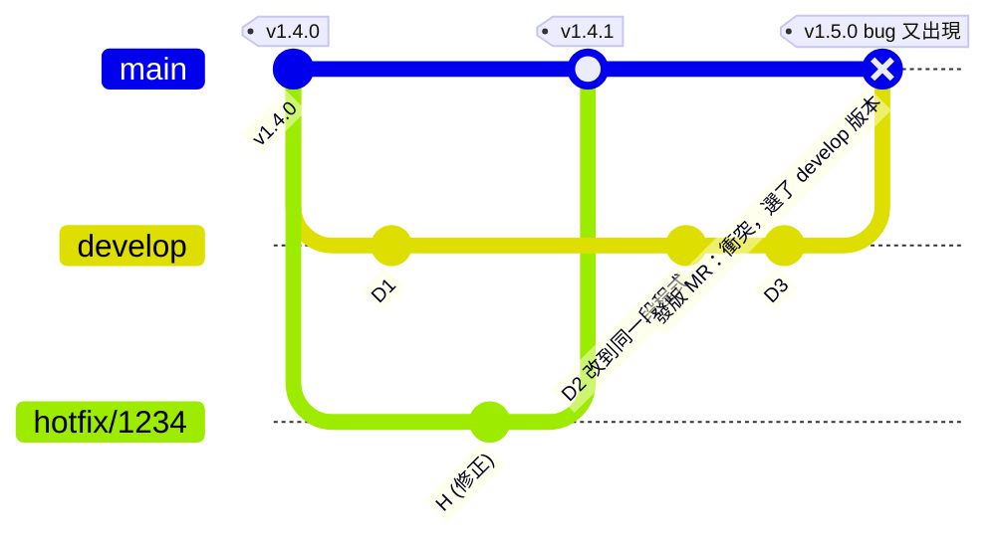

圖中少了一條 `hotfix/1234 → develop` 的回補線，這就是漏掉的那一步。develop 沒有 H，測試環境一直重現同一個 bug；發版 MR 解衝突的人不知道有 H，選了 develop 的版本。

注意：用 merge commit 發版時，Git 不會「自動」丟掉 H。bug 復活是因為衝突時人選錯了版本。只要 H 早就在 develop 裡，衝突會在 develop 上、由最了解程式的人提早解掉。

預防：hotfix 合進 main 的當天就開 MR → develop；發版前用 `git cherry -v develop main` 檢查。

## 7. 其他實用指令：stash、revert、reset、reflog

**公用分支上要「反悔」用 revert（新增一個反向 commit）；只有在自己未 push 的分支上才用 reset（改寫歷史）。**

| 指令 | 做什麼 | 典型情境 |
| --- | --- | --- |
| `git stash` / `git stash pop` | 把還沒 commit 的修改暫存起來，之後拿回 | 開發 feature 到一半，要緊急切去開 hotfix |
| `git revert <hash>` | 產生一個「抵銷」該 commit 的新 commit，不改歷史 | main / develop 上某個功能要撤下 |
| `git revert -m 1 <merge-hash>` | 撤銷一個 merge commit | 整個 feature MR 要從 develop 拿掉 |
| `git reset --soft HEAD~1` | 取消最後一個 commit，修改保留在暫存區 | commit 訊息寫錯、漏加檔案（未 push） |
| `git reset --hard <hash>` | 把分支與工作區全部回到該 commit，之後的修改丟棄 | 自己的分支搞亂了想重來 |
| `git reflog` | 列出 HEAD 曾經指過的每個位置 | reset / rebase 後要找回「不見」的 commit |

```bash
# Urgent hotfix while mid-feature
git stash push -m "wip export"
git switch -c hotfix/1234 v1.4.0
# ...after the hotfix...
git switch feature/1.4.0
git stash pop

# Recover after a bad reset or rebase
git reflog                 # find the entry before the mistake, e.g. HEAD@{3}
git reset --hard HEAD@{3}
```

---

> **SourceTree 操作｜stash、revert、reset、reflog**
>
> - `git stash`：工具列 **Stash** → 填說明 → OK（可勾 Keep staged changes）。
> - `git stash pop`：側邊欄 STASHES → 右鍵 → **Apply Stash** → 勾 Delete after applying。
> - `git revert <hash>`：右鍵 commit → **Reverse commit…**（SourceTree 對 revert 的稱呼）。
> - `git revert -m 1 <merge>`：圖形介面不支援，用 **Terminal**。
> - `git reset`：右鍵目標 commit → **Reset \<branch\> to this commit** → 選 Soft / Mixed / Hard。
> - `git reflog`：沒有圖形介面，用 **Terminal**；找到 hash 後可回 SourceTree 用 Reset 或 Branch… 救回。
>
> Reset 選 **Hard** 會直接丟掉未 commit 的修改且沒有復原鍵，按下前先確認。

---

### 案例：revert 了 merge，修好後再合卻功能不完整

`feature/1.6.0` 合進 develop 後發現嚴重 bug，整批 revert。修好後在同一個 feature 加了 F3 再 MR 一次，結果大部分功能不見了。

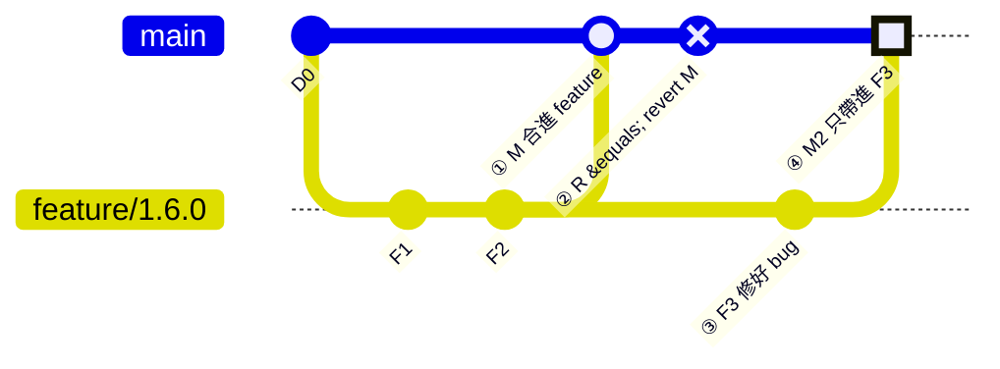

（圖中的 main 線代表 develop。）Git 認為 F1、F2 早就合過了，第二次 merge 只帶進新的 F3。結果 R 撤銷的 F1、F2 仍然是「被撤銷」狀態，develop 上只有 F3 的修改，功能不完整。

正確做法：在 develop 先 revert R（revert the revert），再 merge 帶進 F3。

```bash
git switch develop
git revert <R 的 hash>        # bring F1, F2 back
git merge feature/1.6.0         # now brings in F3
```

## 8. 怎麼選：merge、rebase、cherry-pick 速查

**口訣：要整個分支用 merge，要整理自己的歷史用 rebase，只要一兩個 commit 用 cherry-pick。**

| 你想做的事 | 用什麼 | 指令 / 操作 | SourceTree |
| --- | --- | --- | --- |
| feature 開發完成回 develop | MR（squash 或 merge） | GitLab MR `feature/x → develop` | Push 後到 GitLab 開 MR |
| 發版到 PRD | MR（merge commit）+ tag | MR `develop → main`，`git tag -a vX.Y.0` | MR 合併後：切 main → Pull → Tag（勾 Push tag） |
| feature 跟上最新 develop（只有自己在用） | rebase | `git rebase origin/develop` + `--force-with-lease` | 右鍵 origin/develop → Rebase current changes onto… → Push 勾 Force push |
| feature 跟上最新 develop（多人共用） | merge | `git merge origin/develop` | 右鍵 origin/develop → Merge … into current branch |
| 整理零碎 commit | interactive rebase | `git rebase -i HEAD~N` | 右鍵 commit → Rebase children of … interactively |
| 線上緊急修 bug | hotfix 分支 | 從線上 tag 開，MR → main，打 PATCH tag | 右鍵 tag 的 commit → Branch… |
| hotfix 回補 develop | MR 或 cherry-pick | MR `hotfix/x → develop` 或 `git cherry-pick -x <hash>` | 切 develop → 右鍵 fix commit → Cherry Pick |
| 撤掉已合進公用分支的修改 | revert | `git revert <hash>` / `git revert -m 1 <merge>` | 右鍵 commit → Reverse commit…（merge commit 用 Terminal） |
| 找回弄丟的 commit | reflog | `git reflog` + `git reset --hard HEAD@{n}` | Terminal 執行 reflog，再右鍵 Reset / Branch… |

### 建議在 GitLab 上設好的保護

- [ ] `main`、`develop` 設為 Protected branch：Allowed to push = No one，Allowed to merge = Maintainers。
- [ ] 禁止對 `main`、`develop` force push。
- [ ] MR 需至少 1 人 approve 且 CI pipeline 通過才能合併。
- [ ] Protected tags：`v*` 只允許 Maintainer 建立。
- [ ] 開啟「Delete source branch after merge」，避免舊 feature/hotfix 堆積。

## 9. 綜合演練：從 v1.4.0 到 v1.5.0

**兩個人同時開發、中途線上出 bug，最後一起發版。前面每一節的功能，都會在這一個週期裡用到。**

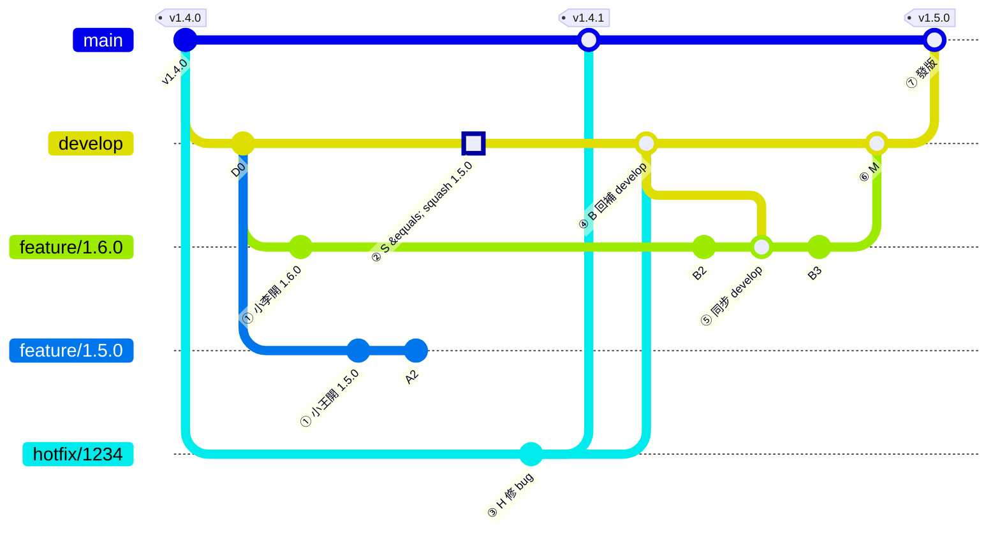

| 步驟 | 誰 | 發生什麼 | 指令重點 | SourceTree |
| --- | --- | --- | --- | --- |
| ① | 小王、小李 | 各自從 develop 開 feature | `git switch -c feature/1.5.0`（另一人 1.6.0） | Branch → New Branch |
| ② | 小王 | 匯出功能完成，MR squash 進 develop | GitLab MR `feature/1.5.0 → develop`，勾 Squash | Push 後到 GitLab 開 MR |
| ③ | 小王 | 線上出 bug #1234，從 v1.4.0 開 hotfix，MR 進 main，打 v1.4.1 | `git switch -c hotfix/1234 v1.4.0`、`git tag -a v1.4.1` | 右鍵 tag 的 commit → Branch…；Tag |
| ④ | 小王 | hotfix 回補 develop | GitLab MR `hotfix/1234 → develop` | 到 GitLab 開 MR；或 Cherry Pick |
| ⑤ | 小李 | 把最新 develop（含 S、B）帶進自己的 feature，先在這裡解衝突 | `git merge origin/develop`（只有自己用也可 rebase） | 右鍵 origin/develop → Merge into current branch |
| ⑥ | 小李 | 報表功能完成，MR 進 develop | GitLab MR `feature/1.6.0 → develop` | Push 後到 GitLab 開 MR |
| ⑦ | Maintainer | 發版：MR develop → main（merge commit），打 v1.5.0 | `git tag -a v1.5.0`、`git push origin v1.5.0` | 切 main → Pull → Tag（勾 Push tag） |

重點檢查：④ 若漏做，就是第 6 節的「bug 復活」案例；⑤ 讓衝突在 feature 上解掉，⑥ 的 MR 才會是乾淨的；⑦ 如果勾了 squash，就是第 2 節的案例。
